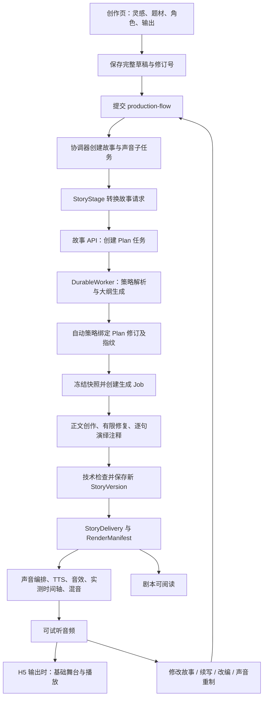

# AI 玩具故事生成：本地引擎与集成项目交接梳理

整理日期：2026-11-11。目的：建立下一轮故事生成流程、交互策略和体验优化的共同基线。本次只做代码审阅、差异核对和离线验证，未修改业务代码、启动服务或调用付费模型。

## 1. 基线与结论

| 项目 | 核对基线 | 定位 |
|---|---|---|
| 本地 StoryGenerate | `H:/Projects/StoryGenerate`；分支 `codex/story-formula-integration`；提交 `7122474` | 故事算法、规则、提示词、工作流和交付协议研发仓库 |
| 集成项目 my-legend | `codex/theme-scenes-v0.6`；提交 `b7c24db2cc4a6c52b270c07ff2aa0e14c1850a77` | uni-app 前端、生产 API、协调器、故事服务、声音制作和 H5 演绎 |
| 集成代码审阅副本 | `H:/Projects/my-legend-handoff-20261111` | 单独克隆的指定分支，供本轮只读比对 |

用户所说的“线上”在本文指 GitHub 集成分支。没有核验远程部署、实际运行版本、数据库、模型凭据或设备；仓库材料中的运行证据主要来自同事本机 H5，不能据此认定玩具端或公网生产已验收。

**核心判断：集成版已对故事引擎作实质扩展，后续优化应以当前集成行为为产品基线，在本地研发改进后进行有选择的合并。**

- 本地正式入口是 `workflow.StoryWorkflowService`，旧 `graph.py/run_pipeline` 是兼容链路，不宜作为本轮主入口。
- 集成默认走“先试听，再修改”：大纲由自动策略绑定具体修订和指纹，再生成正文；保留冻结快照，但不等待人工确认。
- 最新创作页默认输出 H5，亦支持剧本、音频；H5 流程先走故事与声音，再衔接基础舞台。不能仅沿用 10 月 20 日“默认广播剧”的旧说明。
- 集成补齐了故事 HTTP 服务、持久任务、Worker 租约、版本操作、声音桥接和制作恢复，不只是给本地引擎套了一层 API。
- 技术可交付、语义已审核、用户满意是不同状态；`listen_first` 下语义检查标志保持未通过并附跳过说明，不能用任务成功推断故事质量合格。

## 2. 当前用户路径与真实调用链

主要入口与职责：

| 层 | 关键文件（相对各仓库） | 当前职责 |
|---|---|---|
| 本地引擎服务 | `4-引擎代码/drama_engine/workflow/service.py` | 准备/修订 Plan、审批快照、生成、交付校验、版本保存 |
| 本地创作 | `workflow/adapters.py`、`storycraft_prompts.py`、`creative_context.py` | 大纲、正文、演绎注释、创作上下文、质量核验 |
| 策略 | `workflow/strategy.py` 与 `3-规则库` | Mode、Genre、Recipe、Template 确定性解析及提示注入 |
| 创作前端 | `source/fingertip-legend-app/src/pages/create/index.vue` | 完整草稿、角色选择、输出选择、一键制作 |
| 作品前端 | `src/pages/flow/index.vue`、`services/api.ts` | 分阶段状态、剧本/声音/舞台、版本、修改、恢复 |
| 制作协调 | `source/my-legend-production/src/my_legend_production/production/flows.py` | 作品流程与声音/舞台子任务关联、版本操作、恢复 |
| 故事桥接 | `production/story.py` | 请求转换、轮询上游状态、调用额度、来源及新版本验证 |
| 生产策略 | `production/story_guard.py` | 绑定生产请求、附加创作约束、审核策略、预算与时长范围 |
| 故事 HTTP 服务 | 集成引擎 `drama_engine/service/api.py`、`runtime.py`、`worker.py` | HTTP 契约、排队、持久状态、租约、执行隔离、恢复 |
| 实际启动包装 | `ops/my-legend/run_story_worker.py` | 包装模型参数、结构输出、调用预算和执行器 |

集成引擎根目录为 `source/StoryGenerate-0dec8480e3c1b01af66407ff063f825a3fd5dedb`。目录里的历史 SHA 不是当前代码版本号。

### 2.1 新建请求实际传递了什么

创作页 `payload()` 提交 `source.kind=creative`，包含标题、灵感、四选一中文题材、角色 ID，以及 `target_duration_seconds=null`。输出是 `script/audio/h5`，当前页面默认 `h5`；H5 还包含人物及服装绑定。

`FlowService.sound_request()` 创建生产请求，固定 `mode=automatic`、`review_policy=listen_first`、`sound_workflow=sound_bridge/1`、`audio_delivery_policy=audio_first`。纯剧本输出会在后续调整为仅 script。

`StoryStage.plan_body()` 转为引擎请求：

- `intent=create`，用户标题和灵感合成为 `user_instruction`。
- `genre` 原样传入中文题材，`story_mode=general`，`target_episodes=1`，`ending_preference=closed`。
- 角色映射为 `character_id → role_id → performer_id`。
- null 时长变为 `duration_mode=auto`，不发送固定 `target_duration_sec`。
- `client_context.production` 带生产任务 ID 和请求哈希，用于实际 Worker 追溯生产策略。
- H5 的可用场景名称通过 `creation_library.with_scene_choices()` 加入创作输入；因此故事地点已受舞台素材影响。

大纲模型从既有的 90/120/150/180/300 秒篇幅中选择时长，服务将结果写入解析后的偏好和冻结指纹。这里是篇幅预算，实际音频时长由下游实测时间轴确定。

### 2.2 审核策略如何真正生效

生产策略没有仅靠故事请求的一个同名字段直传。真实启动器使用 `production_worker_class(DurableWorker)`，通过 `client_context.production` 读取并校验父生产任务，向 provider 注入 `production_review_policy`、`production_duration_bounds` 和必要的草稿策略。

因此，只在本地直接实例化 `ApprovedPlanLLMExecutor`，或只启动未包装的故事 Worker，不能代表实际集成链路。

非旧视觉制作链的 `listen_first` 路径：

1. 不等待人工大纲审批，但保存自动策略执行依据。
2. 保留大纲、正文、演绎标注模型调用。
3. 跳过终稿语义 Judge 和音频可制作性语义审核；技术完整性继续检查。
4. 修改故事时额外执行正文未变保护，必要时在已有预算内定向修复。
5. 保存“未执行语义审核”证据，技术通过后可进入声音制作。

`standard` 和旧 `visual` 输出有其他审核与能力约束，不应把所有分支都概括为“无审核”。H5 flow 的声音子任务与旧 visual 制作任务也不是同一个概念。

## 3. 本地与集成版的代码差异

按 `.py` 文件逐个对比，并归一化换行：本地核心包 108 个 Python 文件，集成核心包 119 个；11 个同名文件有差异、11 个文件仅集成版有，本地没有独占 Python 文件。未把 `__pycache__`、测试产物或生成媒体计入。

| 变化组 | 涉及文件 | 实质变化与合并要求 |
|---|---|---|
| HTTP 与任务服务 | 新增 `service/` 9 个模块 | API、任务视图、持久队列、Worker、角色库、下游 manifest；本地尚无这一层 |
| 来源操作 | 新增 `workflow/operations.py`、`timeline.py` | 修改影响范围、操作要求、来源快照与时间主张校验 |
| 主工作流 | `workflow/service.py`、`repository.py` | 继承旧偏好/角色、自动时长、领取与锁定 Job、执行 token、防旧 Worker 发布、重试/恢复 |
| 正文执行 | `workflow/adapters.py` | 续写追加与旧集保留、局部修改、连续性累积、生产策略钩子、先试听发布、操作证据 |
| 数据契约 | `workflow/schemas.py`、`delivery.py` | 新增自动时长、执行 token、操作证据、时间证据、`generated_episode_ids`；导出更适合完整版本 |
| 创作输入 | `workflow/creative_context.py`、`storycraft_prompts.py` | 连续性覆盖、操作要求、自动篇幅提示 |
| 模型适配 | `llm/router.py`、`openai_compat.py` | 操作 Judge 路由与特定网关请求头/session 处理 |
| 版本与持久化 | `config.py`、`persistence/models.py` | Prompt 从本地 `p1.6.5` 到集成 `p1.6.11`，服务任务与租约等持久字段 |

`workflow/strategy.py` 等文件仍相同，已有故事套路能力并未整体丢失；主要问题是产品请求如何选择并传入这些能力。

合并原则：保留集成的服务、来源版本、章节合并、执行隔离与策略钩子；提示词和算法改动应逐项迁移。不能用本地整个 `workflow/` 覆盖集成目录。

## 4. 必须保持的交付与版本约定

### 4.1 故事服务接口

| 接口 | 作用 |
|---|---|
| `POST /v1/plans` → `GET /v1/tasks/{task_id}` | 异步生成大纲，完成后取得 plan_id |
| `GET /v1/plans/{plan_id}` | 获取具体大纲修订、偏好、指纹和角色快照 |
| `POST /v1/plans/{plan_id}/revisions` | 反馈修订大纲 |
| `POST /v1/plans/{plan_id}/approve` | 校验修订、指纹、幂等键并创建正文 Job；接口名不代表必然由人审批 |
| `GET /v1/jobs/{job_id}` | 正文任务状态、错误与用量 |
| `GET /v1/story-versions/{version_id}` | 获取完整结构化交付 |
| `GET /v1/story-versions/{version_id}/render-manifest` | 下游场景/行映射与渲染清单 |

服务还保留取消、重试、谱系、角色导入等接口。前端通常通过业务 `/api/v1/production-flows`、`production-jobs` 访问，不直接管理引擎 Job。

### 4.2 输出与定位

- `StoryDelivery → episodes → scenes → utterances` 是下游共同正文；对白、旁白、音效、音乐、动作不能混成同一种朗读文本。
- 保持 `story_id`、`story_version_id`、父版本、Plan 修订与指纹、`episode_id/scene_id/line_id`、角色与 performer 绑定可追溯。
- `summary` 是剧情/连续性摘要，`preview_blurb` 是播放前无剧透介绍，不应互相代替。
- 台词正文确定后附演绎标注；重音区间按 Unicode 码点解析。改变台词含义应产生新故事版本。
- 集成新增 `generated_episode_ids`，区分“本次生成的集”与“完整版本包含的所有集”。时长与集数检查不能错误地作用于全部历史集。
- 下游接收 StoryDelivery 和 RenderManifest 后还会校验来源、覆盖关系和制品哈希，不能只判断 HTTP 200。

### 4.3 三种已有故事操作

| 操作 | 当前引擎语义 | 用户界面/体验注意点 |
|---|---|---|
| continue | 同一 story，追加新集；旧集保留，角色/偏好继承 | 与“从上次进度继续播放”分开；完整版本音频可能包含旧章节 |
| revise | 同一 story 的新版本；可限定行/场/集/结尾等范围 | 当前 flow 页面主要提交 whole_story；声音局部重制不等于局部改剧情 |
| remix | 新 story、新作品，保留父版本关联 | 需说明保留/改变元素；适配器显式保留源角色与 performer 绑定 |

新 flow 的修改、续写、改编沿用自动时长；旧 flow 冻结了数字时长的仍按原值处理。10 月 20 日文档里的“新增章节约 90 秒”不能作为最新所有操作的统一承诺。

## 5. 已确认的体验问题与优化切入点

以下是代码事实及据此提出的改进方向，尚未作为本轮产品决策或实现。

| 优先级 | 事实/缺口 | 对用户的影响 | 下一轮建议 |
|---|---|---|---|
| P0 | 新建桥接显式固定 general，中文题材不等于引擎 Mode | 选悬疑也不会直接开启 mystery 的专属因果机制 | 定义四种产品题材到 Mode/Genre/Recipe 的稳定映射，允许明确指令覆盖；用相同输入对照验证 |
| P0 | 先试听跳过语义审核，现有正文未变保护只证明发生了变化 | “换了正文”仍可能没有落实用户修改要求 | 把反馈变成可追踪的修改目标、保留项和作用范围；优先做针对性落实核验，避免恢复默认全文反复 Judge/重写 |
| P0 | 生产代码硬时长范围是 30%–160%，提示词却仍称 60%–160% | 时长承诺、提示和真实放行标准不一致 | 先统一配置来源，再决定自动篇幅与用户可选篇幅；区分目标、文本估计与实测音轨 |
| P1 | 本地套路、模板、受众、结局等能力没有完整产品化 | 用户选择少，结果可控性弱；引擎实际采用的策略不透明 | 保持轻入口，提供少量高价值偏好或生成后的方向调整；避免直接展示全部技术参数 |
| P1 | 创作输入主要是灵感、题材、角色 ID；角色资料来自集成目录 | 角色外观选择不一定提供足够欲望、关系、语言习惯 | 核验实际导入角色快照，补充少量稳定角色特点与本次关系，而不是要求用户填完整人物卡 |
| P1 | 前端按剧本/声音/舞台聚合状态，定时读取流程 | 等待原因和下一步价值不够清晰 | 基于已存在阶段与产物告知“可先读剧本/先试听”，为长耗时、等待和可恢复失败提供清晰反馈 |
| P1 | 内容改稿往往触发后续声音制作；跨版本逐句缓存未有全面验收依据 | 小改动也可能等待较长时间并产生额外成本 | 明确剧情、音色/表演、音效三类反馈；优先验证局部修改与素材复用边界，再承诺交互速度 |
| P1 | H5 可用场景通过自然语言附加到创作输入 | 地点选择受素材库影响，可能牵动故事创作 | 将叙事意图与素材约束显式分离；仍保留可渲染地点的确定映射与差异说明 |
| P2 | 代码已有调用用量和供应商成本计算基础，旧文档仍有“尚待实现”口径 | 容易重复开发统计或把估算当账单 | 复用 reported/estimated/unavailable 与既有生产账本；补齐跨阶段体验指标和成本归因 |

时长不一致的具体证据：`production/length_policy.py` 的 `DURATION_HARD_BOUNDS=(0.3,1.6)`；`production/story_guard.py` 的生产说明仍写“60%至160%”。实际非旧视觉生产 Worker 将前者注入 `production_duration_bounds`。本地未注入该范围时默认正文时长校验是 85%–115%。

实际启动器还有额外行为：`MomaStoryExecutor` 的时长修复包装最多尝试三次；模型调用有 12 次上限，并受父任务预算继续约束。只看本地“一次场景修复”的文档会低估某些集成任务的调用上限。

## 6. 建议的职责边界与交接顺序

以下是后续协作建议，不冒充团队已确认分工。

| 负责侧 | 建议主要负责 | 需要共同确认的交界 |
|---|---|---|
| 故事生成团队（我们） | 创作策略、角色创作输入、Plan/正文 Prompt、连续性、修改语义、首稿质量、StoryDelivery 演进 | 产品偏好到策略映射、用户反馈到故事操作、下游所需字段 |
| 后端/集成同事 | API、身份与来源归属、队列/租约、幂等、制作协调、制品与账本、恢复 | 状态与错误码、生产策略注入、版本兼容、模型预算 |
| 前端同事 | 轻创作入口、偏好选择、等待反馈、版本与回放、修改/重制入口 | 操作确认文案、默认值、失败后动作、分阶段可用结果 |
| 声音/视觉同事 | TTS 与声音编排、真实媒体时间轴、舞台素材映射、播放执行 | 演绎提示语义、角色绑定、action/sfx 区分、不可改事实 |

建议下一轮顺序：

1. 先定典型用户场景：随手听一篇、指定角色创作、故事续集、结尾修改、声音不满意。区分故事生成与实时对话/剧情互动；本轮未发现后者已形成同等成熟的产品闭环。
2. 固定当前集成 SHA 为对照组，保留默认先试听和基础舞台的既有行为，再选择要实验的流程。
3. 优先验证题材映射、修改落实和时长规则三项；每次改动绑定明确体验假设。
4. 以相同角色/指令/模型/输出目标跑小样本，分别记录首稿、定向修复、网关失败和下游制作失败。
5. 合并时覆盖引擎、桥接、真实 Worker 包装和前端，不能仅测独立 executor。

建议共同验收指标：首次可读/可试听耗时与 P50/P95、首稿技术通过率、试听接受率、修改要求落实率、角色一致性、续写连续性、每成功作品调用/Token、失败与未知调用成本。生成任务 succeeded 不作为“用户满意”的替代指标。

## 7. 本次验证与证据边界

### 已在本机执行

- 本地：`test_story_strategy.py`、`test_story_delivery.py`、`test_phase10_workflow.py`、`test_llm_usage_accounting.py`，**109 passed**。
- 集成引擎副本：`test_story_operations.py`、`test_story_timeline.py`、`test_phase11_service.py`，**55 passed**。
- 集成生产侧选定的 `test_listen_first.py`、`test_soft_length_policy.py`、`test_production_story.py` 在收集阶段因当前环境缺少 `psycopg` 中止，不能计为通过。当前 Python 是 3.10.11，而生产包声明 3.12+；本轮没有更改环境依赖。

测试均为离线合同/状态/受控 provider 验证。未运行本轮真实模型、PostgreSQL 故障矩阵、前端构建、听感评审、设备链路或远程部署验收。

### 同事历史文档记录（本轮未重放）

10 月 29 日《全流程真实联调》记录了新建、阅读、试听、H5 播放、有效正文修改和舞台另存。也保留了“技术 succeeded 但正文照抄旧版”的无效修改及修复证据；基础舞台闭环通过，听感/观感待人工确认。该历史记录不是本轮代码或线上现状的重新验收。

## 8. 源码与文档导航

以下 GitHub 链接固定在本次审阅提交，避免分支后续移动导致结论无法追溯。

- [集成源码基线](https://github.com/frostdogstarscream/my-legend/tree/b7c24db2cc4a6c52b270c07ff2aa0e14c1850a77)
- [当前创作页](https://github.com/frostdogstarscream/my-legend/blob/b7c24db2cc4a6c52b270c07ff2aa0e14c1850a77/source/fingertip-legend-app/src/pages/create/index.vue)
- [当前作品与反馈页](https://github.com/frostdogstarscream/my-legend/blob/b7c24db2cc4a6c52b270c07ff2aa0e14c1850a77/source/fingertip-legend-app/src/pages/flow/index.vue)
- [故事请求与版本桥接](https://github.com/frostdogstarscream/my-legend/blob/b7c24db2cc4a6c52b270c07ff2aa0e14c1850a77/source/my-legend-production/src/my_legend_production/production/story.py)
- [生产策略与真实 Worker 包装](https://github.com/frostdogstarscream/my-legend/blob/b7c24db2cc4a6c52b270c07ff2aa0e14c1850a77/source/my-legend-production/src/my_legend_production/production/story_guard.py)
- [制作协调与版本操作](https://github.com/frostdogstarscream/my-legend/blob/b7c24db2cc4a6c52b270c07ff2aa0e14c1850a77/source/my-legend-production/src/my_legend_production/production/flows.py)
- [实际故事启动器](https://github.com/frostdogstarscream/my-legend/blob/b7c24db2cc4a6c52b270c07ff2aa0e14c1850a77/ops/my-legend/run_story_worker.py)
- 集成文档：`docs/requirements/my-legend/模型决定故事时长_20261029.md`、`完整创作闭环接入_20261029.md`、`全流程真实联调_20261029.md`；早期参考 `先试听模式_20261020.md`、`指定版本修改续写改编_20261020.md`。
- 本地参考：`docs/WORKFLOW_HANDOFF_PHASE10.md`、`STORY_DELIVERY_CONTRACT.md`、`TEMPLATE_AUTHORING.md`、`PROMPT_MAINTENANCE.md`。历史状态与测试数字应以对应提交理解，不能直接当成当前验收。

后续仍需产品决策的事项：实际目标年龄与使用场景、自动篇幅是否保留可选时长、何种情况才需要用户确认方向、修改作用范围如何呈现、实时玩具交互是否纳入本阶段。现有引擎的受众枚举为 14–17/18–35/36–55，不应仅因“AI 玩具”名称就默认系统已支持更低龄儿童策略。
