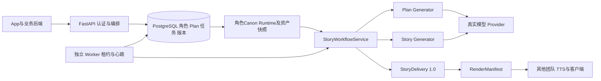
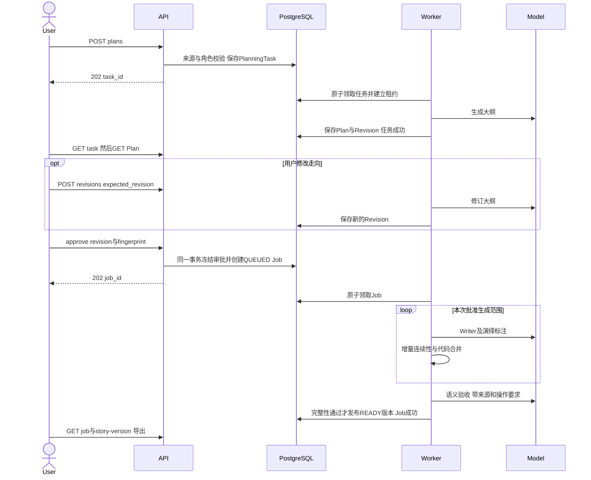
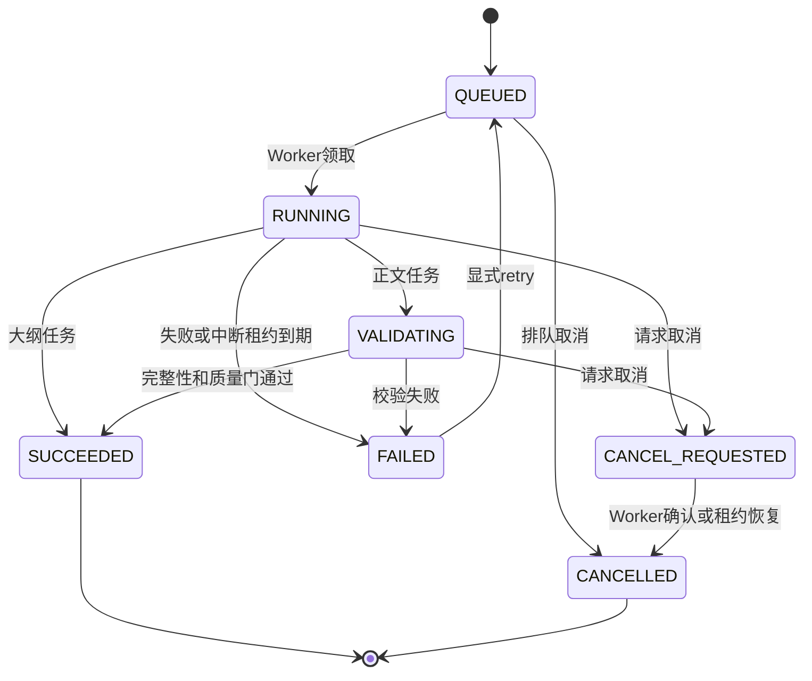

# 01 技术交接：架构、合同及事务

这是任务状态图。Plan主要持久化状态为AWAITING_APPROVAL→APPROVED；大纲生成/修订进度属于Task。Plan的完整枚举中其他值不能被理解成已有相应公开操作。StoryVersion的READY是故事交付状态，不是Job状态SUCCEEDED，也不是音频状态。

|操作|来源和版本关系|范围与合并|适合场景|
|---|---|---|---|
|Create|无来源，新story_id和v1|按批准大纲生成全部目标集|全新想法|
|Revise|同story_id，新version_no，parent指向所选来源|只替换批准范围；其他集/场景/台词及标注一致|已完成内容局部或全篇改动|
|Continue|同story_id，新版本，parent精确来源|target_episodes是新增数量；完整旧集+新集，全局集号连续|在已存在结尾后继续|
|Remix|新story_id，parent仍指向原版本|按保留/变更要求重建状态，不能盲目累加原事实|平行世界、改编|

Revise target不是自然语言模糊定位；先读取版本取得ID，再提交：

|scope|target必须/可选字段|确定性范围|
|---|---|---|
|line|episode_id, scene_id, line_id|一条utterance|
|scene|episode_id, scene_id|一个完整场景|
|episode|episode_id|一集|
|arc|episode_ids数组|存在且按顺序连续的多集|
|ending|可选episode_id、scene_ids|默认最后一集最后一场；指定场景必须是该集连续末尾后缀|
|whole_story|空对象|整个来源故事|

`branch_from_here`保留后续内容并检查冲突，名称不表示自动删除后续。`replan_affected`把之后受影响的集加入审批快照；执行不能越过批准范围。局部修改使用结构化替换结果，由代码合并；仅变化发声行重标注。连续性从替换前状态重新累计，移除被替换增量。

Continue继承来源角色快照、剧情名、演绎者、偏好及连续状态；显式兼容偏好可覆盖，角色身份冲突拒绝。每新增集立即更新摘要、事实、关系、未解线索给下一集。`generated_episode_ids`标记本次生成范围；返回`episodes`始终是完整故事，不能用新增集数覆盖客户端旧集列表。

来源解析→角色/策略解析→大纲快照→审批→执行→确定性与语义检查→持久化→新Session读取→导出。确定性检查验证范围/ID/未修改哈希/版本关系；语义检查接收来源证据、要求和批准范围，需正文证据，不等于文学优秀。

事务边界：API准备任务入库后响应；模型调用在Worker进程执行，不持有整个HTTP请求。批准Plan与创建正式Job原子提交。发布时校验取消与租约token，故事版本/任务结果一致提交；失败不把候选稿发布为READY。相同故事版本号在PostgreSQL事务内串行分配，允许从历史版本派生，不能按parent+1推算。

任务领取使用`FOR UPDATE SKIP LOCKED`；心跳延长租约；到期用数据库`clock_timestamp()`检测。旧执行者的token不能覆盖新尝试或发布结果。Worker重启扫描过期任务→FAILED/取消中→CANCELLED，必须显式重试；API单独重启不负责恢复死亡Worker。累计usage保留attempt history和未知在途用量。并发机制有工程测试，不等于真实高并发容量验收。

数据库模型通过不可变快照连接：StoryPlan→StoryPlanRevision→StoryJob的approved_plan_id/revision→StoryVersion的plan/job/source引用；角色模板与用户profile revisions在Plan/Delivery快照中冻结。确切持久化字段见[models](../../4-引擎代码/drama_engine/persistence/models.py)。历史版本不被新故事/角色更新覆写。
