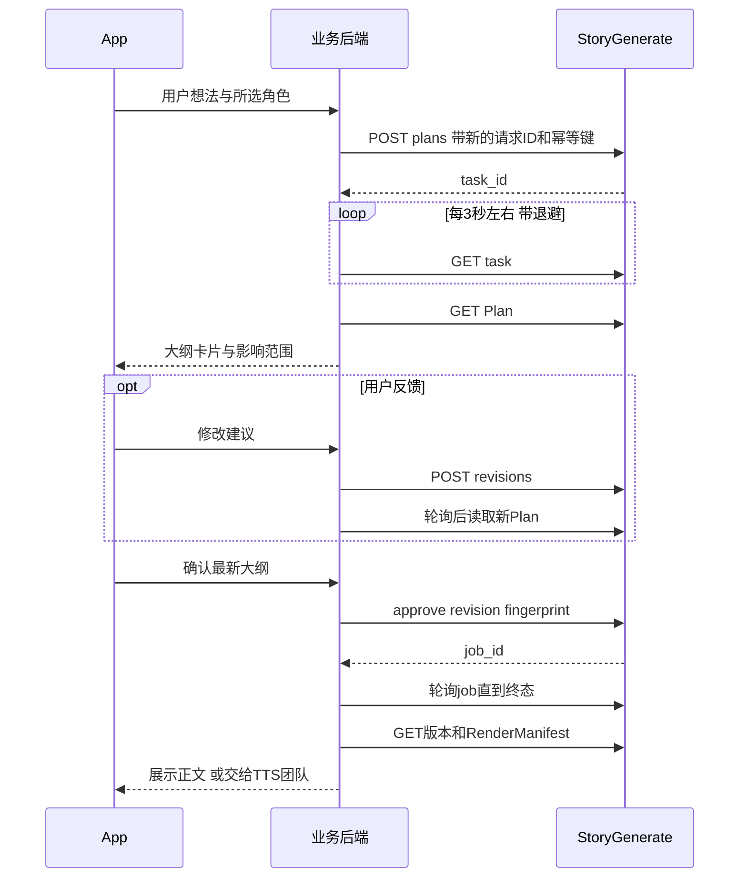

# 07 前端及业务后端联调

业务后端负责用户登录、将用户映射到服务principal、保管Bearer、记录业务会话、提供页面或App交互。此服务提供服务间认证，没有用户注册/JWT/支付接口。不要把共享admin凭据下发App。角色Canon目录对认证调用方共享；Plan、任务、故事与Runtime按principal隔离。404可能是无权限，不能尝试其他租户ID绕过。

推荐页面状态：选角色/输入→准备大纲→可编辑大纲→用户批准→生成中/可取消→正文/导出/历史。必须让用户看到Revise影响范围和Remix保留/变更要求；审批按钮绑定当前revision/fingerprint，反馈后旧按钮失效。任何失败保留原版本和错误；新版本成功才更新当前播放/展示版本。

|标识|实际含义|保存与使用|
|---|---|---|
|request_id|客户端一次逻辑故事请求|长度<=64；服务按principal+原值SHA256映射引擎ID，所以Job.request_id不等于原值|
|idempotency_key|一次动作的重放标识|body字段，<=128；相同网络重发保留，新动作更换|
|task_id|大纲prepare/revise队列任务|202后轮询/v1/tasks；与RenderTask同名字段不同|
|plan_id|可修订大纲标识|反馈仍同ID；审批使用最新修订|
|plan_revision|大纲修订整数|expected_revision并发保护|
|plan_fingerprint|Plan完整审批快照摘要|复制到审批body.fingerprint|
|job_id|正文生成队列任务|审批原子返回；/v1/jobs轮询|
|story_id|一个故事的版本分组|Create/Remix新建；Revise/Continue复用|
|story_version_id|不可变正式版本|用作来源/全文/导出；不是故事分组|
|character_id|公共角色库身份|选择、快照、Canon固定身份|
|role_id / story_role_id|本故事内角色身份|请求role_bindings；输出speaker_role_id引用|
|performer_id|声音/演绎者路由|与资源voice.performer_id一致，不等于角色库ID|
|episode_id / scene_id / line_id|结构化内容定位|必须从实际来源JSON读取，不按显示标题猜测|
|RenderTask.task_id|版本+集+场景+行的哈希|下游演绎任务去重，同版本稳定，新版本会变|
|session_id|可选业务会话参考|不替代认证，也不提供播放会话管理|

四操作完整输入见[API](02-api-reference.md)。用户自然语言放user_instruction；Create设置模式/题材/风格/集数/时长。Revise附source_selector.by_id与edit目标；Continue只设置新增数量及方向；Remix显式retain/transform。不要把客户端的任意字段传入严格Schema，额外字段可能422。

角色：先GET目录和所需版本；已选角色需唯一绑定character_id、role_id或story_role_id、performer_id。角色快照含Canon、Runtime和asset_refs并冻结在Plan与正式版本。非空固定事实不能在故事或Runtime patch里覆盖。用户个性化先GET runtime历史，PATCH expected_revision+允许字段；personality是**字符串数组**，dialogue_style等是字符串。并发时409后重新读取；不盲目覆盖。导入expected_version0只用于新角色，不是幂等重复导入。

轮询HTTP200需要查看status：Task为QUEUED/RUNNING/SUCCEEDED/FAILED/CANCEL_REQUESTED/CANCELLED；Job增加VALIDATING。progress_pct不是ETA。客户端建议3秒起、繁忙时退避到10秒；HTTP请求超时约30秒，任务可持续更久，保存ID后断线恢复。服务不提供SSE/Webhook。FAILED信息在error_code/error_message，含usage和尝试历史；不要因HTTP200就显示生成成功。

幂等命名空间：prepare和Plan feedback共享principal+key；审批使用独立Job键。完全相同请求的重放返回同一任务；改内容必须新key，新逻辑请求还需新request_id。审批使用expected_revision+fingerprint防旧大纲、同时检查所选角色快照版本。网络超时先GET原ID或重放原文件；不要自动生成新key导致重复费用。

错误分支：401更新安全配置；403换有权限的后端身份；404核对principal和来源；409检查幂等、版本、审批与状态；422查看error.details.loc修字段；503保存X-Request-ID给运维。Task/Job业务失败与HTTP失败不同。已取消不可retry，只有FAILED可显式重试；更改要求需新Plan。不存在公共recover接口。

历史：GET stories返回版本摘要列表；GET stories/id/versions取同story全部不可变版本；GET story-version/id/lineage取连通谱系含Remix。历史派生可形成分支，parent不一定是version_no-1。客户端维护自己的“当前展示版本”，不能对旧版本写入正文。

播放中改方向见[04](04-direction-change.md)。服务不保管公开播放进度，不通知播放器切换。真实TTS完成、音频缓存、设备播放状态由其他团队持久化；Job.story_state SUCCEEDED和Delivery READY只代表故事。
