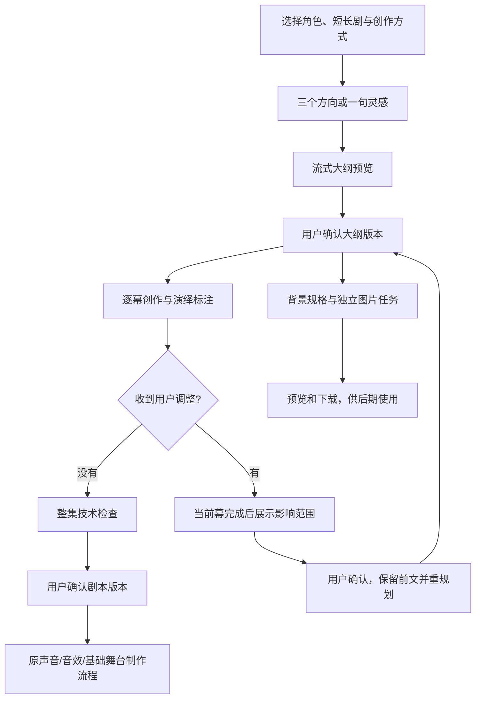

# 故事生成交互升级：我侧功能说明、合并与接入联调方案

> 历史记录：2026-11-12 已收敛为仅故事生成，不再自动启动媒体。当前接入以 [独立交付与契约](故事生成独立交付与接入契约_20261112.md) 及 [本轮测试记录](故事生成独立交付测试记录_20261112.md) 为准。

版本：交互创作会话 v1；日期：2026-11-11。本文供故事团队、业务后端、前端与声音/舞台同事共同接入。

路径约定：引擎脚本、契约、示例及验收汇总的路径相对引擎仓库根目录；在集成仓库中对应 `source/StoryGenerate-0dec8480e3c1b01af66407ff063f825a3fd5dedb/`。集成项目的 ops、前端与生产包路径则相对集成仓库根目录。

## 1. 交付在哪里，怎样理解当前状态

| 仓库 | 交付分支 | 用途 |
|---|---|---|
| `zblds-a/StoryGenerate` | `codex/interactive-story-sessions` | 我侧通用引擎、契约、测试、真实验收脚本与文档 |
| `frostdogstarscream/my-legend` | 本地评审分支 `codex/interactive-story-sessions`，以补丁包交付 | 基于 `codex/theme-scenes-v0.6` 的集成示范：引擎同步、生产 API/Worker、页面、确认后媒体桥接 |

远程交付说明：你方账号 zblds-a 已能推送 StoryGenerate，但对同事仓库 my-legend 的推送返回 HTTP 403。集成代码没有发布到同事仓库的远程分支。完整 Git 补丁包随你方仓库交付，路径为 `docs/handoff/my-legend-interactive-story-sessions.patch`；同事按下文应用即可获得全部集成改动。

两份代码不是让同事二选一整库覆盖。建议集成项目直接评审集成分支；后续算法研发回到引擎仓库。集成目录名称中的旧 SHA 不是本次引擎版本号。

当前能力是**可联调的交互故事创作链路**，新入口默认关闭。真实聊天模型已调用，数据库事务与媒体来源桥接已测试；图片生成供应商及真实 TTS/音效凭据不在本次提供资产中，不能据此宣称真实图片、音质、舞台成品或正式发布已经通过。

测试结果、失败样本和费用统计口径独立见《故事生成交互升级_测试验收报告_20261111.md》。自动技术通过与用户确认，不等于文学质量、安全分级或人工听审合格。

## 2. 我侧做了什么

### 2.1 从选项开始创作

- 短剧：生成一集完整故事。
- 长剧：默认六集，可选择计划集数；先形成系列主线与分集概要，仅生成当前集。确认后按需续写下一集。
- 帮我构思：一次返回三个方向，用户点选即可，不要求填写灵感。
- 我有灵感：保留一句话输入，其他参数可用默认值。
- 续写已有：选择已确认且尚未结束的系列，继承角色身份、声音绑定、主线、历史事实与前集内容。
- 题材、感觉、结局、背景风格采用选项；高级偏好折叠，避免首屏变成长表单。

题材在引擎中有明确映射，不再全部固定到 general：

| 产品题材 | Mode | Genre | Recipe |
|---|---|---|---|
| 国风奇幻 | general | G10 | R11 |
| 冒险成长 | general | G12 | R10 |
| 悬疑推理 | mystery | G11 | R6 |
| 生活治愈 | general | G05 | R5 |

映射经现有 StoryStrategyResolver 校验，并将规则库中的创作机制送入策划和写作。首期由后端统一维护，前端不要自行推断配方。

### 2.2 生成过程可见、可调整

主流程：



大纲有完整确认门；正文生成期间默认不断停。用户可以点击更温暖、更轻松、更紧张、增加互动、节奏更紧凑、保留悬念，以及模型在分幕中提出的剧情方向；补充文字为可选。

调整的实际含义：

| 时机 | 服务行为 |
|---|---|
| 大纲生成中 | 先记录反馈，本次调用结束后合并修订；不把旧大纲放进待确认状态 |
| 大纲完成未确认 | 修订大纲并更新指纹，重新确认 |
| 正文写作中 | 先确认收到，当前幕返回后展示起点和作用范围；接受命令不是已经应用 |
| 改当前/已完成幕 | 由用户确认，从最早受影响幕重写；此前正文保持原样 |
| 只改这一幕 | 保留其他正文，将保护后的内容传入本幕创作上下文 |
| 剧本已确认 | 保存旧交付与旧媒体引用，生成新故事版本，不就地覆盖旧版本 |
| 已知失败 | 可从已完成幕调整后继续；未知供应商结果禁止静默重放，需先对账核对 |

每次有效调整提升 generation_epoch。旧轮次的回调不能发布为当前结果。大纲确认、修改范围确认和剧本确认均绑定具体版本/指纹，避免用户点的是旧内容。

### 2.3 流式不是“把 JSON 原样发给用户”

原生流式启用后，模型的可展示字段在完整解析后形成增量事件；不发送内部 JSON 片段、思考过程和模型提示词。每幕完整生成并完成演绎注释后才发布 scene.ready；整集技术检查通过后才有 script.ready。

不同 attempt_id 代表不同请求/结构修复尝试，前端应替换预览；不得把所有尝试的文字直接拼进最终剧本。未开启原生流式时按幕完整返回，不模拟逐字输出。

正文按幕顺序写作，使用当前幕计划、角色要点及前文事实；演绎标注目前仍与逐幕任务串行。加速措施包括推理参数显式可配、避免无用全文上下文、前置字数预算、有限修复与背景并行。真实首条内容和整集耗时分别统计，不以流式体验冒充总时间已经缩短。

### 2.4 背景提示词与图片

大纲同时生成每幕的地点、时段、环境、氛围、必要/禁止元素及背景提示词。确认分幕后，可启动最多两个图片任务并行处理。

- 全剧统一美术风格，背景不包含主角、字幕和水印，保留角色叠加空间。
- 输出 SceneBackgroundSpec，使用独立 scene_key，不与舞台素材 scene_id 混淆。
- 输出图片最终为 1536×864 PNG；记录原始尺寸、交付尺寸、哈希、供应商和模型。必要时居中裁切为 16:9。
- 规格变化让旧图过期，相同内容按规格哈希复用同用户成功图片。
- 未配置生图模型时明确显示 disabled，仍可获取提示词；失败不阻断剧本与声音制作。
- 图片仅预览和下载，不自动替换原舞台背景，也不修改素材库目录。

首个图片适配器要求 `/images/generations` 支持 b64_json 与 1536x1024 输入尺寸；其他供应商实现 generate(spec)→(bytes,model_id) 即可接入。此次两个聊天模型不能当成图片或 TTS 模型使用。

## 3. 前后端、引擎与媒体侧分工

| 团队 | 本次可直接复用 | 仍需对接完成 |
|---|---|---|
| 我侧故事团队 | 交互策划、分幕写作、角色/行类型/字数约束、连续性输入、演绎标注、调整状态机、背景规格 | 真实业务角色小样本盲评、更多题材/长篇质量优化 |
| 业务后端 | 新业务路由、持久事件/命令、所有者隔离、PG 来源登记、确认后 flow 桥接、Worker 脚本 | 正式身份映射、服务托管、HTTPS/代理、真实图片及声音供应商配置、监控与资源准备 |
| 前端 | uni-app 新页面、选项卡、阶段状态、SSE/轮询、确认/调整、图片下载、原作品页跳转 | 产品文案/视觉细化、真实用户测试、目标终端兼容验证 |
| 声音/舞台 | 确认后的 StoryDelivery 与 RenderManifest，直接进入原链路 | 确认实际音色、素材目录、真实听感/视觉验收；不要求改成消费半成品文本 |

示范前端已提供，不要求前端同事从零写页面；也可以按以下契约重新设计交互。**浏览器持有应用登录令牌，模型 API Key 只进入后端进程，二者不是同一种令牌。**

## 4. 业务 API 与接入顺序

全部路径以 `/api/v1` 为前缀，使用原业务鉴权。成功包装为 `{code:0,message:'ok',data:...}`。新路由错误为 HTTP 状态码及 detail；示范客户端已处理，业务后端可在统一错误层进一步归一化。

| 方法/路径 | 作用 |
|---|---|
| GET `/story-options` | 能力开关、选项、默认值；关闭时 enabled=false |
| POST `/story-sessions` | 幂等创建会话，立即返回快照，不在 HTTP 请求中跑完故事 |
| GET `/story-sessions` | 当前用户最近 100 个会话摘要、可续写标志 |
| GET `/story-sessions/{id}` | 完整当前状态、产物、指纹、待处理调整和 available_actions |
| GET `/story-sessions/{id}/events?after=N` | SSE 增量订阅，支持 Last-Event-ID |
| GET 同上并加 `poll=true` | 非流式端增量轮询，每批最多 200 事件 |
| POST `/story-sessions/{id}/commands` | 提交选择、确认、调整、取消、重试等命令 |
| GET `/story-sessions/{id}/backgrounds/{key}/image` | 经过业务鉴权的当前有效背景图片 |
| GET `/story-sessions/{id}/export` | 获取完整 StoryDelivery、背景规格和制品引用 |

### 4.1 第一轮联调：先用仅剧本模式

先从真实角色目录获取可用 character_ids，再发起：

```json
{
  "idempotency_key": "client-create-unique-001",
  "form": "short",
  "method": "assist",
  "character_ids": ["替换为目录中的实际角色ID"],
  "genre": "生活治愈",
  "feeling": "warm",
  "ending": "happy",
  "art_style": "guofeng",
  "output": "script"
}
```

method=idea 时增加 idea；series 时设置 series_episodes。character_ids 不是角色显示名，更不是模型自行生成的 ID。应用层负责解析并冻结角色档案和 performer 绑定。

按返回会话 ID 订阅事件，然后逐步：

1. directions_ready：用返回的方向 ID 执行 select_direction。
2. outline_ready：使用最新 plan_id、outline_fingerprint 执行 confirm_outline。
3. writing：展示已完成幕和增量预览；用户可执行 change。
4. change_ready：展示 pending_change 的起点、范围和指令，执行 confirm_change。
5. script_ready：展示正式剧本，执行 confirm_script。
6. output=script 时到 confirmed；output=audio/h5 时创建原 production flow，返回 flow_id，进入原作品页继续查询。

### 4.2 命令格式与幂等

```json
{
  "command_id": "client-command-unique-001",
  "expected_revision": 12,
  "kind": "confirm_outline",
  "target_id": "返回的plan_id",
  "fingerprint": "返回的outline_fingerprint"
}
```

上例的 12 是示例值，实际必须使用最新会话 revision。Command.schema.json 是机器可读合同。

| 命令 | 必须绑定的数据 |
|---|---|
| select_direction | target_id=方向 ID |
| revise_outline / change | option_id 或 text；可选 target_id=scene_key；scope=scene/following |
| confirm_outline | target_id=plan_id，fingerprint=outline_fingerprint |
| confirm_change | fingerprint=pending_change_fingerprint |
| confirm_script | target_id=delivery.story_version_id，fingerprint=script_fingerprint |
| next_episode | 返回 next_creation，用该描述及固定幂等键创建后续会话 |
| retry_background | target_id=失败背景的 scene_key |
| retry / cancel | 仅在 available_actions 允许时提交 |

相同 command_id 和输入返回原 receipt；换输入报冲突。版本过期返回 409，前端更新快照后让用户核对，不自动确认新版本。响应 receipt.status=accepted 表示命令已接收，不等于剧情已变化。

示例调整：`kind=change, option_id=warmer, target_id=实际scene_key, scope=following`。不传目标时优先调整尚未开始内容；改当前幕要明确传当前 scene_key。

### 4.3 SSE 规则

事件信封：event_id、seq、session_id、revision、generation_epoch、type、occurred_at、payload。

主要事件为 stage.changed、outline.delta/ready、scene.started/text.delta/ready/invalidated、change.accepted/proposed/applied、background.spec.ready/started/ready/failed/stale、script.ready/confirmed、media.started、generation.failed/cancelled。change.rejected 为预留事件名，当前未接受的命令通过 HTTP 409 返回，前端不要等待该事件。

- seq 在会话内递增；重复事件去重，断线按最后处理序号续传。
- 以 generation_epoch 隔离过期内容，以 attempt_id/chunk_index 区分正文预览尝试。
- ready 事件和快照才是正式内容；自动定向修复会先 invalidated 再 ready。
- 心跳是 SSE 注释，不推进事件序号；连接约 50 秒后重连不表示生成失败。
- 使用 fetch 流携带 Authorization，不直接依赖无法自定义授权头的原生 EventSource。
- 代理关闭缓冲，保留 text/event-stream；不要对 GET/刷新请求添加生成副作用。
- 首期保留完整事件；订阅不会取消任务，用户离开页面与取消生成是两回事。

## 5. 合并代码的建议步骤

### 集成项目同事

```powershell
git fetch origin
git switch codex/theme-scenes-v0.6
git switch -c integration/interactive-story-review
git am --3way "已下载的my-legend-interactive-story-sessions.patch的本机完整路径"
```

补丁从 `zblds-a/StoryGenerate` 的交付分支 `docs/handoff/` 下载，或在其克隆中取得；不要对我侧引擎仓库执行该 git am。补丁基于 my-legend 的 b7c24db，应用到同事自己的 my-legend 克隆。应用成功后由有写权限的同事推送评审分支并创建合并请求。发生冲突时先核对源版本，再使用 git am --continue；不接受本次导入时可 git am --abort，原目标分支不受影响。

先在评审分支合并，不直接覆盖生产目录。本交付基于原集成基线 b7c24db；如果目标分支已前进，优先保留同事已有 service、来源版本、Worker 租约、声音和舞台改动，再处理本次新增的 interactive 模块和路由。

主要冲突点是 production/api.py、production/repository.py、前端 pages.json、create 页面和导航类型。新增会话模块与页面相对独立。不要把 StoryGenerate 本地旧 workflow 整目录复制回集成项目。

### 单独维护引擎的同事

```powershell
git fetch origin
git switch -c review/interactive-story origin/codex/interactive-story-sessions
python -m pip install -e '.[dev]'
python -m pytest tests/unit tests/integration -q
```

PG 集成测试需另设 TEST_DATABASE_URL 指向隔离测试库。引擎仓库没有完整业务前后端；只合并该仓库不会自动出现前端新页面。

## 6. 后端部署与配置

生产示范包使用 Python 3.12。安装集成 engine 的 editable 包以及生产包 `[production]`。会话与原生产仓库共用 PostgreSQL DSN 和 schema，不连接本次验收专用容器。

```powershell
python -m pip install -e 'source/StoryGenerate-0dec8480e3c1b01af66407ff063f825a3fd5dedb[dev]'
python -m pip install -e 'source/my-legend-production[production]'
python ops/my-legend/run_interactive_story_worker.py --migrate
```

迁移只新增 interactive_story_sessions 和 interactive_story_sources；前者存储会话/事件/命令与执行证据，后者登记已确认的媒体来源。关闭功能不删除历史数据。

Worker 进程配置如下，密钥从部署环境注入，不写代码、前端或 Git：

```powershell
$env:MY_LEGEND_INTERACTIVE_STORIES = '1'
$env:DRAMA_LLM_BASE_URL = 'http://yunshu.xzmoma.cn:3001/v1'
$env:STORY_LLM_FAST_MODEL = 'deepseek-v4.1-flash-1017'
$env:STORY_LLM_BALANCED_MODEL = 'deepseek-v4.1-flash-1017'
$env:STORY_LLM_STRONG_MODEL = 'qwen/deepseek-v4-pro'
$env:STORY_INTERACTIVE_STREAMING = '1'
$env:STORY_INTERACTIVE_THINKING = 'disabled'
python ops/my-legend/run_interactive_story_worker.py
```

业务 API 同样设置 MY_LEGEND_INTERACTIVE_STORIES=1 后按原部署方式重启。新 Worker 单独托管，不由旧启动器自动接管。模型 Key 使用 DRAMA_LLM_API_KEY，仍需原生产 DSN/runtime 和故事角色服务配置；不要把示例中的 URL 当成完整部署配置。

图片另外配置 STORY_IMAGE_BASE_URL、STORY_IMAGE_API_KEY、STORY_IMAGE_MODEL，缺一项即关闭图片执行。声音与舞台沿用既有供应商/素材设置，不将聊天模型配置套给 TTS。

前端无需写入模型参数，只需要现有业务 API 地址和登录态。打开原创作页，能力探测 enabled=true 时出现“一起创作”入口；新路由为 `/pages/story-session/index`。feature=false 时旧页面照常工作。

## 7. 联调验收清单与问题归属

| 场景 | 通过标准 | 优先定位 |
|---|---|---|
| 纯选项短剧 | 无必填灵感，能选方向、确认大纲并得到一集 | 选项/角色解析与规划合同 |
| 长剧首集与续写 | 六集主线、只写当前集、父版本和历史集保留 | 系列上下文与 source_session |
| 大纲修改 | 旧指纹不能确认，新大纲有新修订 | 会话 CAS、前端快照 |
| 正文生成中修改 | 显示已接收，幕边界停下，确认后保留前缀 | pending_change、epoch、ready 替换 |
| 单幕修改 | 其他场景正文完全不变，目标要求写进正文 | protected_prefix/suffix 与真实正文比较 |
| 页面刷新/重连 | 不重复生成、不混尝试、不丢已完成幕 | seq 游标、attempt_id、幂等 |
| 剧本确认门 | 未确认不发媒体制作，重复确认无重复 flow | script 指纹、来源登记、flow 幂等 |
| 取消在途请求 | 后续不再调用，迟到结果不发布；未知用量保留 | Worker fencing、调用账本 |
| 背景失败/改场景 | 失败不阻断故事，旧图过期，下载需鉴权 | 独立图片任务与规格哈希 |
| 跨用户访问 | 读取、事件、图片、确认与媒体来源均拒绝越权 | 业务 owner、来源注册表 |
| 最终声音/舞台 | 使用确认版本、音轨与时间轴可追溯 | 原媒体链路与实际素材/供应商配置 |

测试状态必须区分模型调用、自动技术检查、手工内容审阅及真实听审。存在素材缺失或供应商未知结果时不可拿测试替身算真实发布成功。

## 8. 可直接转给前后端的交接说明

本次已交付交互故事创作 v1，提供独立 story-sessions API、可恢复事件流、逐幕输出、场景边界修改、两次内容确认门及背景规格/图片任务。集成分支已经包含 uni-app 示例页和确认后接回原声音/基础舞台流程的适配代码。

请先合并到联调分支，部署新增会话表和独立 Worker，使用仅剧本模式验证角色、方向选择、大纲确认、正文流、修改及重连。随后配置原声音/舞台资产，打开 audio/h5 输出验证确认门和版本关系；生图服务单独配置。模型密钥仅后端持有。

当前新入口默认关闭；本次真实模型和数据库证据以验收报告为准。旧素材库中缺失的演员图集/字体等需要素材负责方提供，真实图片/TTS/音效验收需要对应供应商配置。请不要把“剧本可联调”理解为整套媒体资产已随 Git 交付。
